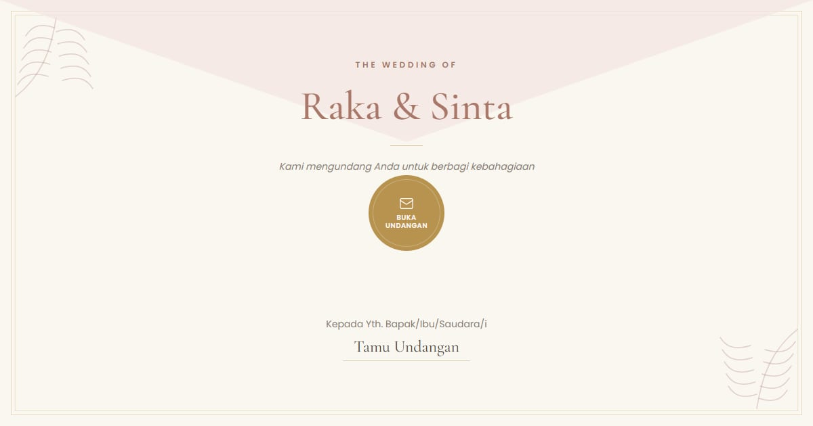

# Undangan Digital — Wedding

**Demo live:** https://undangan-wedding-eight.vercel.app



> Undangan contoh dengan data fiktif. Formulir RSVP hanya demo dan tidak mengirim data.

Template undangan pernikahan digital. Dibangun dengan **Next.js 15 (App Router)**, **React 19**, **Tailwind CSS v4**, **Framer Motion**, dan ikon **lucide-react**.

Ini adalah **template emas**: pola & struktur di sini dipakai sebagai basis untuk varian undangan lain (engagement, khitanan, aqiqah, birthday, wisuda, korporat, reuni).

## Menjalankan

```bash
npm install
npm run dev
```

Buka http://localhost:3000

## Konsep utama: pisah DATA dari TAMPILAN

Seluruh isi undangan (nama, tanggal, acara, galeri, rekening, dll) ada di **satu file**:

```
lib/data.js
```

Untuk memakai ulang template ini, cukup ubah `lib/data.js` — komponen tidak perlu disentuh.

## Fitur

- Layar sampul (cover) dengan **nama tamu personal** lewat URL: `?to=Nama%20Tamu`
- Hero, quote pembuka, profil mempelai
- Countdown menuju hari H
- Rangkaian acara (akad & resepsi) + lokasi (Google Maps embed)
- Love story / timeline
- Galeri foto
- Amplop digital (salin nomor rekening)
- RSVP & Ucapan — **mode demo**: data tidak dikirim ke mana pun, dan pesan suksesnya mengatakan itu terus terang (siap dihubungkan ke backend)
- Musik latar (taruh file di `public/music/song.mp3`)

## Struktur

```
app/
  layout.js        # font + metadata
  page.js          # rangkai semua section + state buka undangan
  globals.css      # token tema (warna & font)
lib/
  data.js          # >>> SEMUA ISI UNDANGAN DI SINI <<<
  hooks.js         # useCountdown, useGuestName
components/
  ui/Reveal.jsx, ui/SectionTitle.jsx   # komponen UI bersama
  Cover, Hero, Opening, CoupleSection, CountdownTimer,
  EventDetails, LoveStory, Gallery, MapEmbed,
  GiftSection, RSVPForm, WishesForm, Footer, MusicPlayer
```

## Catatan

- Foto memakai placeholder `picsum.photos` (lihat `lib/data.js`). Ganti dengan foto asli.
- Tambahkan file `public/music/song.mp3` agar musik latar berfungsi.

---

Bagian dari koleksi 8 undangan digital di [PortalUndangan](https://portal-undangan-eta.vercel.app). Dibuat oleh [PintuWeb](https://pintuweb.com), jasa pembuatan website.
